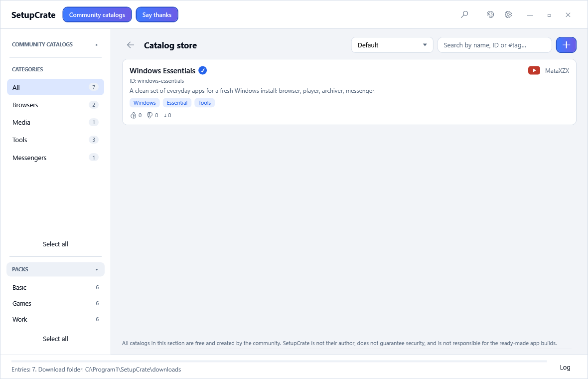

# SetupCrate

A small Windows app: a personal catalog of official installer links with one-click downloads — your own “Ninite”, plus a community store of ready-made app packs.


## Screenshots

| Light | Dark | Glass |
|---|---|---|
|  |  |  |

Community store:



## Features

- **Portable catalog.** All entries are stored in `catalog.json` next to the app — easy to move to a USB drive, sync or back up.
- **Direct installer links.** Name, website, direct file link, category and notes.
- **Link search on a page.** Enter a site address and the app finds suitable `.exe/.msi/.zip` files and lets you pick one.
- **Batch downloads.** Download selected entries or the whole catalog in parallel, with progress and resume (`HTTP Range`).
- **Signature check.** After download the Authenticode signature is checked, and SHA‑256 if provided.
- **Link check.** HEAD-check of the whole catalog or an opened pack: dead links are visible immediately.
- **Installer runner.** Runs installers one by one, with silent-install flags when specified.
- **Installed detection.** Reads the Windows Uninstall registry and shows installed programs with their version.
- **Categories.** Create, rename, delete and reorder by drag and drop.
- **Ready-made packs.** Basic, Games and Work — a separate list that never touches your catalog.
- **Community store.** Free packs published by other users: search by name, ID or `#tag`, sort by downloads, likes, dislikes, verified packs or YouTubers.
- **Publishing.** Share one of your own categories as a pack: pick the category, add a short description and tags, accept the responsibility disclaimer and send it to the store.
- **Verified and YouTube badges.** Packs checked by the author of SetupCrate get a checkmark; YouTuber packs show a YouTube button that opens the author's channel.
- **Import and export.** Move or back up the catalog as JSON.
- **Three themes.** Light, Dark and Glass (acrylic blur where supported).

## Requirements

- Windows 10 or Windows 11, 64-bit.

## Install

1. Open the [latest release](https://github.com/MataXZX/SetupCrate/releases/latest).
2. Download `SetupCrate.exe`.
3. Put it in any folder and run it — no installation required.

`catalog.json`, `settings.json` and the `downloads/` folder appear next to the exe on first launch.

## Usage

1. Add programs: name, direct installer link, category.
2. Tick the entries you need (or take a ready-made pack).
3. Press **Download selected** — installers are saved to `downloads/`.
4. Press **Install**, or open the folder and run them manually.

Also available: **Check links** — verify the whole catalog, **Settings → Check for updates** — look for a newer app version.

## Community store

Open the store with the **Community catalogs** button in the header.

- Find a pack by name, ID or `#tag`, open it, read the description and press **Download pack**.
- Downloaded packs appear in the sidebar under **Community catalogs** and never change your own catalog or categories.
- A pack may show a blue checkmark (verified by SetupCrate) and a YouTube button (opens the author's channel).
- The flag button on a pack page opens a report form; you can also hide the pack from your list.

To publish your own pack: **Community catalogs → +**, choose the category to share, fill in the name, author, description and tags, then confirm that you are responsible for the contents.

SetupCrate does not check user packs and is not responsible for their contents, links, installers or security. Download and install at your own risk.

## Windows SmartScreen

The release file is not code-signed yet, so Windows may show **“Windows protected your PC”** on the first launch. Click **“More info”** → **“Run anyway”**.

If you wish, verify the downloaded file against the SHA-256 from the release notes:

```
certutil -hashfile SetupCrate.exe SHA256
```

## Support the project

If SetupCrate is useful to you, you can thank the author: [boosty.to/mataxzx/donate](https://boosty.to/mataxzx/donate).

## License

[MIT](LICENSE)

---

# SetupCrate

Небольшое приложение для Windows: личный каталог ссылок на официальные установщики и скачивание одной кнопкой — свой собственный «Ninite», а ещё магазин готовых сборок от сообщества.


## Скриншоты

| Светлая | Тёмная | Стекло |
|---|---|---|
|  |  |  |

Магазин каталогов:


## Возможности

- **Портативный каталог.** Все записи хранятся в `catalog.json` рядом с программой — легко перенести на флешку, синхронизировать или сохранить в бэкап.
- **Прямые ссылки на установщики.** Название, сайт, прямая ссылка на файл, категория и заметки.
- **Поиск ссылок на странице.** Вводите адрес сайта — приложение находит подходящие `.exe/.msi/.zip` и предлагает выбрать файл.
- **Пакетное скачивание.** Скачивание отмеченных записей или всего каталога параллельно, с прогрессом и докачкой (`HTTP Range`).
- **Проверка подписи.** После загрузки проверяется Authenticode-подпись, при необходимости — SHA‑256.
- **Проверка ссылок.** HEAD-проверка всего каталога или открытого пака: сразу видно, что перестало работать.
- **Запуск установщиков.** По очереди, с поддержкой флагов тихой установки.
- **Определение установленного.** Чтение реестра Windows (Uninstall) и показ уже установленных программ с версией.
- **Категории.** Создание, переименование, удаление и сортировка перетаскиванием.
- **Готовые пакеты.** «Базовый», «Игры», «Работа» — отдельный список, не затрагивающий ваш каталог.
- **Магазин каталогов.** Бесплатные сборки от других пользователей: поиск по названию, ID или `#тегу`, сортировка по скачиваниям, лайкам, дизлайкам, проверенным пакам и пакам ютуберов.
- **Публикация.** Поделиться своей категорией как паком: выбрать категорию, добавить короткое описание и теги, подтвердить ответственность и отправить в магазин.
- **Галочка «проверено» и YouTube.** Проверенные автором SetupCrate паки получают галочку; у паков ютуберов появляется кнопка YouTube с переходом на канал автора.
- **Импорт и экспорт.** Перенос или бэкап каталога в JSON.
- **Три темы.** Светлая, тёмная и «Стекло» (акриловый blur там, где поддерживается).

## Требования

- Windows 10 или Windows 11, 64 бита.

## Установка

1. Откройте [последний релиз](https://github.com/MataXZX/SetupCrate/releases/latest).
2. Скачайте `SetupCrate.exe`.
3. Положите в любую папку и запустите — установка не требуется.

Файлы `catalog.json`, `settings.json` и папка `downloads/` появятся рядом с exe при первом запуске.

## Как пользоваться

1. Добавьте программы: название, прямая ссылка на установщик, категория.
2. Отметьте нужные записи (или возьмите готовый пакет).
3. Нажмите **Скачать отмеченные** — установщики сохранятся в `downloads/`.
4. Нажмите **Установить** или откройте папку и запустите вручную.

Дополнительно: **Проверить ссылки** — проверка всего каталога, **Настройки → Проверить обновления** — поиск новой версии приложения.

## Магазин каталогов

Магазин открывается кнопкой **«Каталоги сообщества»** в шапке.

- Найдите пак по названию, ID или `#тегу`, откройте его, прочитайте описание и нажмите **«Скачать пак»**.
- Скачанные паки появляются в сайдбаре в разделе **«Каталоги сообщества»** и не меняют ваш каталог и категории.
- У пака может быть синяя галочка (проверен SetupCrate) и кнопка YouTube (переход на канал автора).
- Кнопка-флажок на странице пака открывает форму жалобы; там же можно скрыть пак из своего списка.

Чтобы опубликовать свой пак: **«Каталоги сообщества» → +**, выберите категорию, заполните название, автора, описание и теги, подтвердите, что содержимое — ваша ответственность.

SetupCrate не проверяет пользовательские сборки и не отвечает за их содержимое, ссылки, установщики и безопасность. Скачивание и установка — на ваш страх и риск.

## SmartScreen в Windows

Релизный файл пока без цифровой подписи, поэтому при первом запуске Windows может показать **«Windows защитила ваш компьютер»**. Нажмите **«Подробнее»** → **«Выполнить всё равно»**.

При желании проверьте скачанный файл по SHA-256 из описания релиза:

```
certutil -hashfile SetupCrate.exe SHA256
```

## Поддержать проект

Если SetupCrate оказался полезен — можно отблагодарить автора: [boosty.to/mataxzx/donate](https://boosty.to/mataxzx/donate).

## Лицензия

[MIT](LICENSE)
