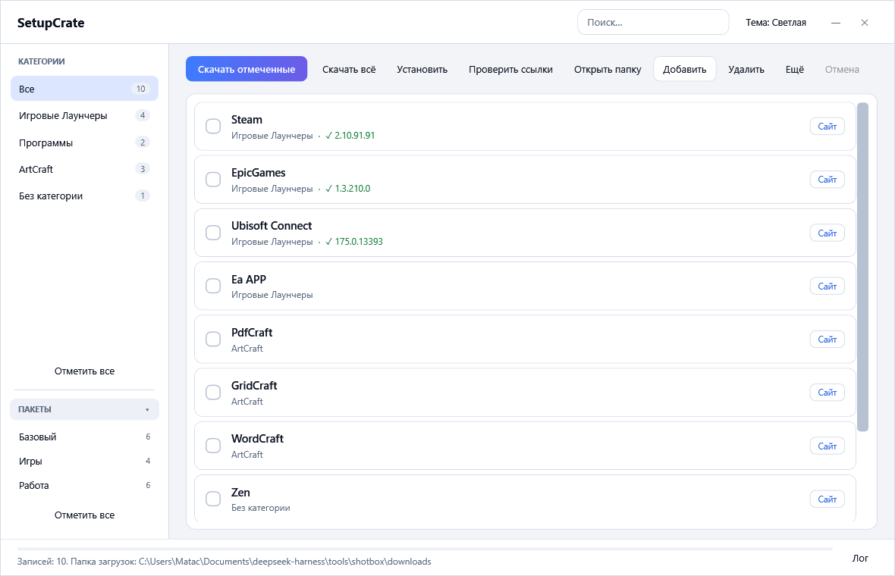

# SetupCrate

A small Windows app for keeping a personal catalog of installer links and downloading them in one click — your own lightweight "Ninite", with three themes (Light, Dark, Glass) and full control over install paths.

## Features

- Portable catalog in `catalog.json` next to the exe — easy to move, sync or back up.
- Add entries: name, website, direct download URL, category, notes.
- "Find links on page" — scans a site for `.exe/.msi/.zip` candidates and lets you pick one.
- Download selected / all, in parallel, with progress and resume (`HTTP Range`).
- Authenticode signature check after download (plus optional SHA-256).
- "Check links" — HEAD-check the whole catalog, so dead links are visible at a glance.
- "Run installers" sequentially, with optional silent-install flags.
- "Installed" detection via the Windows Uninstall registry.
- Import / export the catalog.
- Categories: create, rename, delete, drag-and-drop reorder.
- Built-in preset packs (Basic / Games / Work) kept fully separate from your own catalog.
- Three themes: **Light**, **Dark**, **Glass** (DWM acrylic blur where supported, falls back to a translucent gradient everywhere).

## Screenshots

| Light | Dark | Glass |
|-------|------|-------|
|  |  |  |

## Build

Requires the .NET 10 SDK.

```
dotnet publish SetupCrate.csproj -c Release -r win-x64 --self-contained true -p:PublishSingleFile=true
```

or simply run `build.cmd`.

Output: `bin\Release\net10.0-windows\win-x64\publish\SetupCrate.exe` — a self-contained single file, no runtime required on the target machine.

## Usage

1. Run `SetupCrate.exe`.
2. Add programs, tick the ones you want, press **Скачать отмеченные** ("Download selected").
3. Installers are saved to `downloads\` next to the app; run them and choose your install path.

Everything stays local. `catalog.json` is portable.

## License

[MIT](LICENSE)
