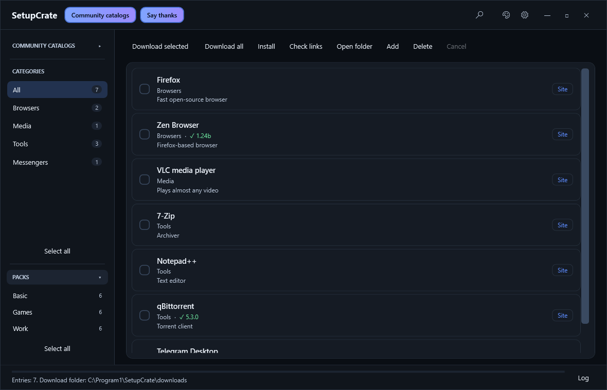

# SetupCrate

A small Windows app: a personal catalog of official installer links with one-click downloads — your own “Ninite”.


## Screenshots

| Light | Dark | Glass |
|---|---|---|
|  |  |  |

## Features

- **Portable catalog.** All entries are stored in `catalog.json` next to the app — easy to move to a USB drive, sync or back up.
- **Direct installer links.** Name, website, direct file link, category and notes.
- **Link search on a page.** Enter a site address and the app finds suitable `.exe/.msi/.zip` files and lets you pick one.
- **Batch downloads.** Download selected entries or the whole catalog in parallel, with progress and resume (`HTTP Range`).
- **Signature check.** After download the Authenticode signature is checked, and SHA‑256 if provided.
- **Link check.** HEAD-check of the whole catalog: dead links are visible immediately.
- **Installer runner.** Runs installers one by one, with silent-install flags when specified.
- **Installed detection.** Reads the Windows Uninstall registry and shows installed programs with their version.
- **Categories.** Create, rename, delete and reorder by drag and drop.
- **Ready-made packs.** Basic, Games and Work — a separate list that never touches your catalog.
- **Import and export.** Move or back up the catalog as JSON.
- **Two languages.** Russian and English, picked automatically from the system language or manually in Settings.
- **Three themes.** Light, Dark and Glass (acrylic blur where supported).

## Requirements

- Windows 10 or Windows 11, 64-bit.

## Install

1. Open the [latest release](https://github.com/MataXZX/SetupCrate/releases/latest).
2. Download `SetupCrate.exe`.
3. Put it in any folder and run it — no installation required.

`catalog.json`, `settings.json` and the `downloads/` folder appear next to the exe on first launch.

## Usage

1. Add programs: name, direct installer link, category.
2. Tick the entries you need (or take a ready-made pack).
3. Press **Download selected** — installers are saved to `downloads/`.
4. Press **Install**, or open the folder and run them manually.

Also available: **Check links** — verify the whole catalog, **Settings → Check for updates** — look for a newer app version.

## Windows SmartScreen

The release file is not code-signed yet, so Windows may show **“Windows protected your PC”** on the first launch. Click **“More info”** → **“Run anyway”**.

If you wish, verify the downloaded file against the SHA-256 from the release notes:

```
certutil -hashfile SetupCrate.exe SHA256
```

## License

[MIT](LICENSE)

---

# SetupCrate

Небольшое приложение для Windows: личный каталог ссылок на официальные установщики и скачивание одной кнопкой — свой собственный «Ninite».


## Скриншоты

| Светлая | Тёмная | Стекло |
|---|---|---|
|  |  |  |

## Возможности

- **Портативный каталог.** Все записи хранятся в `catalog.json` рядом с программой — легко перенести на флешку, синхронизировать или сохранить в бэкап.
- **Прямые ссылки на установщики.** Название, сайт, прямая ссылка на файл, категория и заметки.
- **Поиск ссылок на странице.** Вводите адрес сайта — приложение находит подходящие `.exe/.msi/.zip` и предлагает выбрать файл.
- **Пакетное скачивание.** Скачивание отмеченных записей или всего каталога параллельно, с прогрессом и докачкой (`HTTP Range`).
- **Проверка подписи.** После загрузки проверяется Authenticode-подпись, при необходимости — SHA‑256.
- **Проверка ссылок.** HEAD-проверка всего каталога: сразу видно, что перестало работать.
- **Запуск установщиков.** По очереди, с поддержкой флагов тихой установки.
- **Определение установленного.** Чтение реестра Windows (Uninstall) и показ уже установленных программ с версией.
- **Категории.** Создание, переименование, удаление и сортировка перетаскиванием.
- **Готовые пакеты.** «Базовый», «Игры», «Работа» — отдельный список, не затрагивающий ваш каталог.
- **Импорт и экспорт.** Перенос или бэкап каталога в JSON.
- **Два языка.** Русский и английский, выбор автоматически по языку системы или вручную в настройках.
- **Три темы.** Светлая, тёмная и «Стекло» (акриловый blur там, где поддерживается).

## Требования

- Windows 10 или Windows 11, 64 бита.

## Установка

1. Откройте [последний релиз](https://github.com/MataXZX/SetupCrate/releases/latest).
2. Скачайте `SetupCrate.exe`.
3. Положите в любую папку и запустите — установка не требуется.

Файлы `catalog.json`, `settings.json` и папка `downloads/` появятся рядом с exe при первом запуске.

## Как пользоваться

1. Добавьте программы: название, прямая ссылка на установщик, категория.
2. Отметьте нужные записи (или возьмите готовый пакет).
3. Нажмите **Скачать отмеченные** — установщики сохранятся в `downloads/`.
4. Нажмите **Установить** или откройте папку и запустите вручную.

Дополнительно: **Проверить ссылки** — проверка всего каталога, **Настройки → Проверить обновления** — поиск новой версии приложения.

## SmartScreen в Windows

Релизный файл пока без цифровой подписи, поэтому при первом запуске Windows может показать **«Windows защитила ваш компьютер»**. Нажмите **«Подробнее»** → **«Выполнить всё равно»**.

При желании проверьте скачанный файл по SHA-256 из описания релиза:

```
certutil -hashfile SetupCrate.exe SHA256
```

## Лицензия

[MIT](LICENSE)
